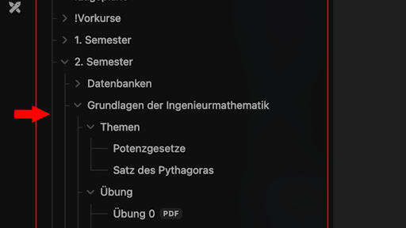
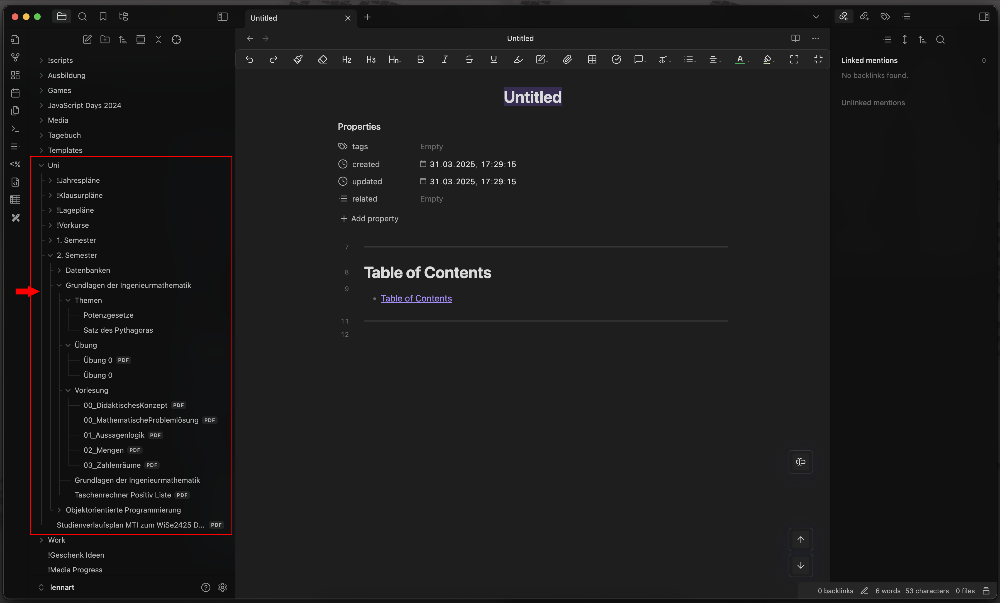

# Enhanced file explorer tree

An [Obsidian](https://obsidian.md/) theme that connects the items in the file explorer with tree lines, so you can see at a glance which files belong to which folder. Everything else stays Obsidian's default look.



## Features

- **Connected tree lines**: every item inside a folder branches off a vertical line, and the last item closes it with a corner, like a classic directory tree:

  ```
  Folder
  ├─ file
  ├─ folder
  │  └─ file
  └─ file
  ```

- **Follows Obsidian's layout**: all positions come from Obsidian's own variables, so the lines stay aligned with other font sizes, zoom levels, deep nesting, on mobile and in the right sidebar.
- **Light and dark mode**: the lines use Obsidian's indentation guide color and follow the mode you pick in Obsidian.
- **Minimal**: nothing outside the file explorer is changed.



## Customization

The theme has no settings of its own, but you can override its variables in a [CSS snippet](https://help.obsidian.md/snippets):

| Variable | Default | Meaning |
| --- | --- | --- |
| `--eft-line-color` | Obsidian's indentation guide color | Color of the lines |
| `--eft-line-width` | `1px` | Thickness of the lines |
| `--eft-stub-gap` | `4px` | Space between a branch and the folder arrow or file name |

Example snippet:

```css
body {
    --eft-line-color: var(--interactive-accent);
    --eft-line-width: 2px;
}
```
